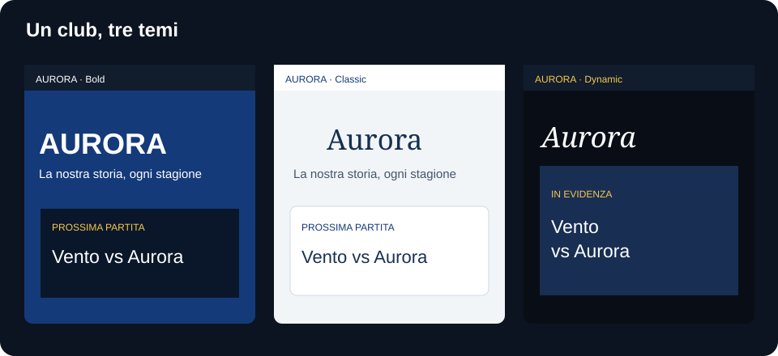
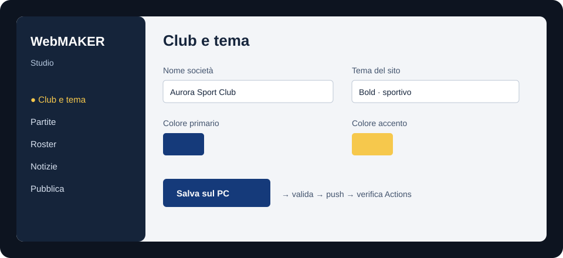
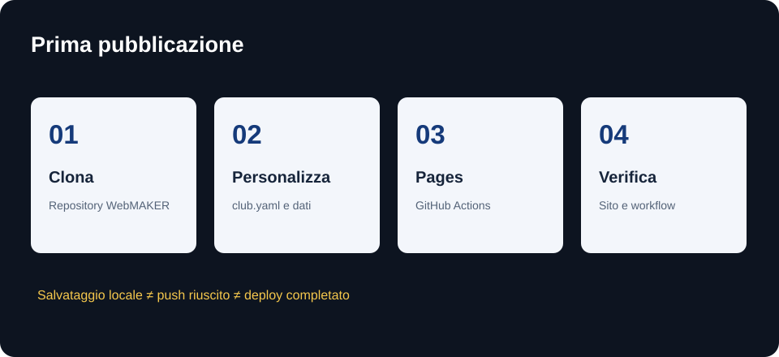

# WebMAKER

WebMAKER creates static websites for sports clubs. This repository contains the site generator, three themes, WebMAKER Studio for Windows, fictional sample data, and an initializer for new clubs. Studio grew out of the Nerone Basket pilot, whose code was written by the PlayMAKER author. The code is licensed under Apache-2.0; retain the [NOTICE](NOTICE) file when redistributing it. See the [migration audit and current limitations](docs/migration-audit.md).



## User guide

### 1. Create your club with Studio 0.2

Select **Create a new club** on the Studio home screen. Enter the club name, short name, sport, theme, first season, and destination. Studio creates an independent project from its bundled starter, removes the fictional sample identity, initializes a clean `main` branch, and opens the project automatically.

To publish during setup, select **Create and publish a GitHub repository**, connect through the Git Credential Manager browser flow, and choose a GitHub user or organization plus a new repository name. Studio creates a public repository, pushes the complete starter, enables the GitHub Pages workflow, and reports the expected site URL. The credential stays in the operating-system credential store and is never written into the club repository.

Use **Clone from GitHub** for a WebMAKER club that is not on this computer, or **Open existing project** for an already-cloned repository. See the [complete Create Club guide](docs/create-club.md).

### 2. Customize your club

Use **Club & theme** in Studio or open `site/data/club.yaml`. Set the name, tagline, description, contact details, language, time zone, colors, sport, `site_url`, `repository_url`, and `base_path`. Choose `theme: bold`, `classic`, or `dynamic`; switching themes does not duplicate or replace your content. Add teams, players, games, rosters, and news through Studio or their files under `site/data/` and `site/content/news/`. Keep IDs stable after publication. Add only images you have permission to use to `site/public/assets/`.

Set `sport: basketball` or `football`, or add a structured profile under `shared/profiles/`. WebMAKER keeps `site/data/teams.yaml`, `site/data/players/*.yaml`, and `site/data/rosters.csv` for TagMAKER roster imports. Per-game statistics CSV files are separate from TagMAKER's event JSON export.



An AI coding agent can help with customization. Give it `site/data/club.yaml`, the fictional CSV/YAML examples, and the [configuration schema](shared/site-0.1.schema.json). Ask it to change content or theme settings, review its diff, then run `npm test` and `npm run build`. Keep private player information, minors' photos, credentials, and unlicensed content out of prompts. For layout changes or a new sport, work on a separate branch and check every page.

### 3. Preview and publish with GitHub Pages

```bash
cd ../my-club/site
npm ci
npm test
npm run build
npm run dev
```

Open `http://localhost:4173` to preview the site. When Create Club publishes during setup, the repository URL, Pages URL, base path, initial commit, remote, push, and Pages configuration are prepared automatically. Continue using Studio's guarded **Publish** screen for later content changes.

For source-based setup without the Studio wizard, clone WebMAKER and run the initializer:

```bash
git clone https://github.com/PlayMAKER-apps/webmaker.git
cd webmaker
node scripts/init-club.mjs ../my-club
```

The source workflow still requires creating the remote, configuring `repository_url`, `site_url`, and `base_path`, pushing `main`, and selecting GitHub Actions in **Settings → Pages**. The `.github/workflows/deploy.yml` workflow builds and publishes the static site. Studio is never hosted on the server. Wait for the workflow to succeed, then open the public URL. A successful Git push does not mean the site has finished deploying.



### 4. Edit with WebMAKER Studio for Windows

Download the [WebMAKER Studio 0.2.0 installer](https://github.com/PlayMAKER-apps/webmaker/releases/download/v0.2.0/WebMAKER.Studio_0.2.0_x64-setup.exe) or view [all releases](https://github.com/PlayMAKER-apps/webmaker/releases). Install Git for Windows with Git Credential Manager for Create Club, clone, synchronization, and publishing. To run Studio 0.2 from source, install Node.js 22+, Rust/MSVC, Visual Studio Build Tools, WebView2, and Git for Windows, then run this in `studio/`:


```powershell
npm ci
npm test
npm run build
npm run tauri dev
```

To build an installer, run `npm run tauri build` and check `studio/src-tauri/target/release/bundle/`. Open the Git root of **one club project at a time** in Studio. Under **Club & theme**, change the name, colors, and theme. Select **Save locally**, then **Publish** to validate, review the diff, and push. Publishing is allowed only from `main` when `origin` exactly matches `repository_url` in the club configuration. Git Credential Manager handles authentication; Studio does not store a personal access token. Remote conflicts block the push. Check GitHub Actions for the deployment result.

## Attribution appreciated

If you publish a club site or post made with WebMAKER, a credit is appreciated but optional: **[WebMAKER](https://github.com/PlayMAKER-apps/webmaker) by [PlayMAKER](https://github.com/PlayMAKER-apps)**. A site footer or post description is a convenient place for it. This request does not change the Apache-2.0 license; if you redistribute WebMAKER code, retain the required [LICENSE](LICENSE) and [NOTICE](NOTICE).

## Contribute to WebMAKER

Open an issue with a clear problem and a fictional example. Fork the repository, make a focused change on a branch, and send a pull request. For the site, run `cd site && npm ci && npm test && npm run build`. For Studio, run `cd studio && npm ci && npm test && npm run build` and `cargo test --manifest-path src-tauri/Cargo.toml`. Review the [migration audit](docs/migration-audit.md) and the [PlayMAKER shared schema](https://github.com/PlayMAKER-apps/playmaker-schema) before changing IDs or formats. Format changes need a new schema version and a nondestructive migration.

The [hardening checklist](docs/hardening-checklist.md) explains browser snapshots, CI audits, and checks that still require a person.

Write documentation, interface text, example content, screenshots, and release notes in English so the whole PlayMAKER community can use them. Existing technical IDs and published data formats must remain stable unless a migration is provided.

The Nerone social graphics generator is not included yet because its club assets and logic still need to be separated. The three **website themes** are distinct from social graphics templates.

## Repository layout and limitations

| Directory | Contents |
| --- | --- |
| `site/` | Static generator, fictional data, three themes, and tests |
| `studio/` | Tauri 2 + React/TypeScript desktop app |
| `shared/` | Configuration schema and sport profiles |
| `starter/` | Instructions for creating a club instance |
| `docs/` | Migration audit, release notes, and guide illustrations |

Each club repository receives a copy of the site generator in this version. Updates require a manual review and pull request; GitHub templates do not synchronize existing projects automatically. Studio can manage multiple local club repositories, one at a time, without mixing drafts or backups.
